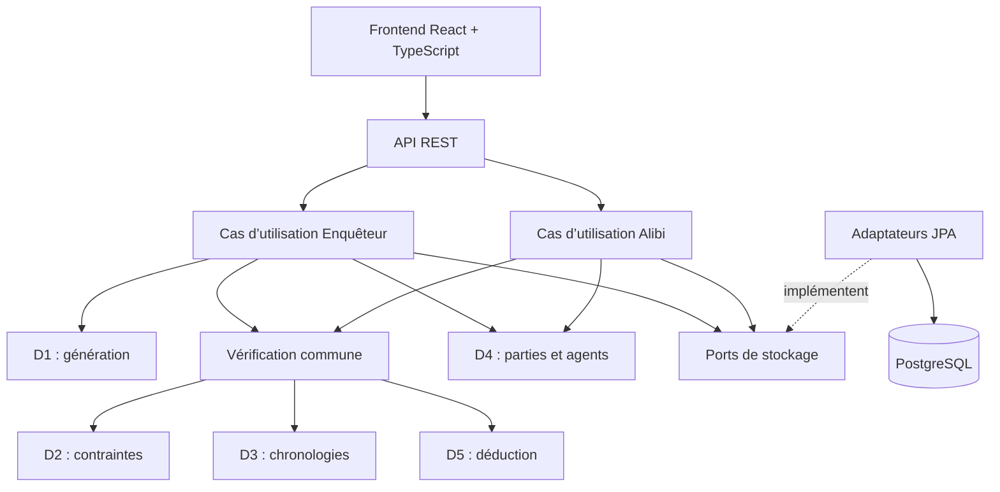

# Architecture MINDCRIME

Cette documentation décrit l’architecture prévue du projet. Le dépôt contient la documentation et son outillage PDF ; aucun backend, frontend, schéma de base de données ou test applicatif n’est encore implémenté.

## Vue d’ensemble

**Front → API REST → Back → BD**

Le backend sera une application Spring Boot unique, organisée en modules métier Java : un **monolithe modulaire**. Son moteur commun alimentera les deux modes. Ce choix permet de tester et d’intégrer les algorithmes de D1 à D5 dans un même programme.

| Couche | Choix MINDCRIME envisagé |
| --- | --- |
| Front | React + TypeScript : enquêtes, interrogatoires et chronologies |
| API REST | Spring Boot 4 / Spring MVC, /api/v1, OpenAPI / Swagger UI ; WebSocket pour les notifications |
| Back | Java 21 : moteur métier pur, cas d’utilisation et interfaces de persistance |
| BD | PostgreSQL 17, Spring Data JPA, migrations Flyway ; Bean Validation aux entrées API |
| Qualité | JUnit 5, Mockito, AssertJ, ArchUnit, JaCoCo, Checkstyle ; GitHub Actions, Codecov et SonarCloud prévus |

Arborescence cible propre au projet, à implémenter :

```text
backend/src/main/java/fr/miage/mindcrime/
├── api/
│   ├── rest/                 actions des joueurs et données visibles
│   ├── websocket/            notifications de partie
│   └── dto/                  entrées, réponses et erreurs API
├── application/
│   ├── enqueteur/            générer, interroger, accuser
│   ├── alibi/                témoigner, interroger, analyser
│   └── port/                 contrats d’accès au stockage
├── moteur/                   domaine commun, Java pur
│   ├── modele/               Partie, Enquete, Suspect, Preuve...
│   ├── generation/           D1 : génération et backtracking
│   ├── contraintes/          D2 : cohérence et contradictions
│   ├── chronologies/         D3 : temps, graphes et déplacements
│   ├── parties/              D4 : règles et états de partie
│   ├── agents/               D4 : comportements et interrogatoires
│   └── deduction/            D5 : hypothèses et explications
└── infrastructure/
    ├── persistence/          adaptateurs JPA, entités et dépôts
    └── configuration/        assemblage Spring, CORS, WebSocket
backend/src/main/resources/db/migration/  schéma Flyway
backend/src/test/java/fr/miage/mindcrime/  tests métier et intégration
frontend/src/                 écrans React, appels API, événements
doc/                          dossier, features, objectifs IA
site/                         page de projet prévue
```

Le moteur ne dépendra ni de Spring, ni de JPA, ni de l’interface. Les cas d’utilisation appelleront le moteur et les ports de stockage ; les adaptateurs JPA implémenteront ces ports. L’API appellera les cas d’utilisation et ne contiendra pas d’algorithmes métier. Des tests ArchUnit devront vérifier ces frontières. Cette séparation par ports et adaptateurs conserve les principes hexagonaux tout en organisant le code autour des besoins de MINDCRIME.

## Un moteur commun aux deux modes



Le graphe représente les appels des cas d’utilisation ; les dépendances de code restent dirigées vers les contrats et le moteur. La vérification commune est une orchestration des capacités D2, D3 et D5 dans la couche application ; ce n’est pas un second solveur. Elle sera utilisée après une génération et après un nouveau témoignage. Le générateur ne dépendra pas directement de JPA ou des contrôleurs : l’application pilotera la génération et la vérification, puis acceptera ou rejettera le candidat.

La chronologie proposera les contraintes de présence et de déplacement ; le module de contraintes vérifiera la cohérence logique des déclarations ; la déduction explorera et expliquera les hypothèses à l’aide de ces résultats, sans confier au module D3 la désignation du coupable. Pour D3-A et D3-B, un petit réseau fixe et entièrement défini sera fourni dès v0.1.0, indépendamment de la carte générée par D1 en v1.0.0. Le périmètre initial suppose des durées de trajet fixes et non négatives : D3-A vérifie un déplacement, D3-B une suite d'événements ordonnés avec fenêtres horaires et attente possible. Une information manquante mène à un résultat non vérifiable ; une impossibilité n'est conclue que dans le réseau déclaré complet. Les détails des contrats Java restent à concevoir. Les cycles entre modules seront évités en faisant coordonner les échanges par les cas d’utilisation et en partageant uniquement des modèles métier et des interfaces explicites.

## Répartition des responsabilités

| Responsable | Packages métier principaux | Responsabilité fonctionnelle |
| --- | --- | --- |
| D1 — Mohamed BOUGHMADI | moteur/generation | Construire des candidats par génération procédurale et backtracking |
| D2 — Yacine FERDJALLAH | moteur/contraintes | Satisfaction, propagation de contraintes et contradictions |
| D3 — Melissa BENZIDANE | moteur/chronologies | Graphes temporels, Dijkstra et faisabilité des déplacements |
| D4 — Mohamet THIAM | moteur/parties, moteur/agents | États des parties, comportements des suspects et du détective, interactions multijoueurs |
| D5 — Salah-Eddine BEKKARI | moteur/deduction | Recherche d’hypothèses, élimination et explications |

L’équipe définira ensemble `moteur/modele`, les contrats entre modules, les conventions API et le schéma commun. D4 sera le référent fonctionnel du cycle de partie ; l’application, l’API et la persistance seront complétées collectivement par chaque porteur de feature.

Les packages ne constituent pas des zones réservées à un seul étudiant : chacun portera ses fonctionnalités de bout en bout dans les quatre couches, avec des modifications relues par les autres. Une feature majeure ne sera pas réduite à un CRUD, une optimisation ou un changement d’écran. Les quinze objectifs de livraison sont détaillés dans [PLAN_FEATURES.md](PLAN_FEATURES.md).

## Modèle commun et persistance

**Partie** sera l’entité pivot : identifiant, mode, état et participants. Elle reliera l’enquête, les suspects, les preuves, les témoignages, les événements temporels et les déductions. Il s’agit d’un modèle conceptuel, pas encore d’un schéma physique ni d’une classe unique regroupant tout le moteur.

Les objets de `moteur/modele` seront des objets Java sans annotations JPA. L’infrastructure définira séparément ses entités persistantes et leurs correspondances avec le métier. Les ports de stockage décriront les besoins des cas d’utilisation ; Spring Data JPA fournira leur implémentation. Chaque feature précisera ses propres migrations et son contrat de persistance.

PostgreSQL sera la base cible, Flyway versionnera le schéma. Une migration publiée ne sera pas réécrite. Des données de démonstration reproductibles sont prévues. H2 pourra servir à certains tests ; les particularités PostgreSQL seront vérifiées sur PostgreSQL.

## Flux des deux modes

Enquêteur : demande de partie → génération d’un candidat → vérification commune avec les indices accessibles → rejet ou acceptation du candidat → enregistrement → affichage des informations visibles. Les interrogatoires, l’analyse d’indices et l’accusation réutiliseront les règles de partie et le moteur. Les réponses de l’API devront exclure les informations cachées. Une unicité fondée sur des informations inaccessibles au joueur ne suffira pas.

Alibi : témoignage → contrôle des entrées et de l’état de partie → vérification logique et temporelle → mise à jour des hypothèses et explications → enregistrement → réponse REST et notifications des participants concernés. Le moteur conservera l’incertitude si plusieurs scénarios restent possibles.

WebSocket notifiera les événements temps réel ; REST restera identifiable dans chaque feature. Le backend assurera la cohérence des actions multijoueurs et de leurs écritures ; les règles de concurrence et de transaction seront précisées lors de la conception. Le frontend présentera les données et recueillera les interactions, sans exécuter les algorithmes de déduction.

## Priorité au backend et progression des versions

1. Définir le modèle Partie, les contrats entre modules et les critères des premières features.
2. Mettre en place le projet Java/Spring Boot, puis développer les algorithmes de chaque domaine avec leurs tests unitaires, indépendamment de la base et du frontend.
3. Assembler les cas d’utilisation, les ports et les adaptateurs de persistance ; vérifier les échanges entre les modules.
4. Exposer les fonctionnalités par REST, puis construire les écrans qui permettent de les utiliser et les notifications temps réel nécessaires.
5. Vérifier les scénarios complets et préparer build, qualité, CI/CD, documentation et démonstration.

La priorité backend décrit l’ordre de développement ; chaque feature livrée devra néanmoins produire un résultat utilisable sur BD → backend → API REST → frontend. La démarche détaillée reste idéation → back → tests → API REST → front.

Chaque algorithme, modèle, cas d’utilisation ou contrôleur aura des fichiers nommés selon son rôle. Un étudiant travaillera sur plusieurs classes cohérentes, pas dans un fichier géant portant son nom. Les mêmes modules évolueront en v0.1.0, v0.2.0 et v1.0.0 ; les branches et les tags Git conserveront les versions. Il n’est pas prévu de dupliquer le code dans des dossiers par étudiant ou par release.

## Tests et livraison prévus

JUnit 5, AssertJ et Mockito : algorithmes, invariants, cas limites et services ; ArchUnit : absence de dépendances techniques dans le moteur et respect des frontières ; tests d’intégration : persistance, API et scénarios. JaCoCo et Checkstyle suivront couverture et règles de style. Codecov, SonarCloud et GitHub Actions sont envisagés, sans résultat annoncé.

Docker Compose est prévu pour PostgreSQL dès v0.1.0, puis pour l’application en v0.2.0. La CI devra construire le logiciel et la documentation ; les releases devront joindre le JAR et le dossier PDF. Une page de projet sera publiée sur GitHub Pages. Seule la compilation documentaire locale `make -C doc` est disponible actuellement.

L’organisation propre à MINDCRIME conserve l’architecture front → API REST → back Java → BD et les exigences de traçabilité individuelles décrites par le [guide du professeur](https://github.com/pascalpoizat/template-projet-m1-miage/blob/main/documentation.md), consulté le 20 octobre 2026 (commit `3a11a780f5912bb3876e7ed7902b5cd8f377eb8e`). Le choix d’un découpage par moteur métier et cas d’utilisation remplace l’arborescence générique du modèle. Aucun code applicatif n’est créé par cette documentation.
