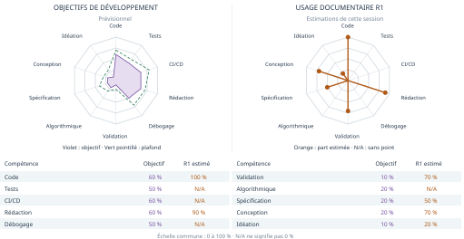

# MINDCRIME

**Dossier de lancement · M1 MIAGE Apprentissage · Université Paris Nanterre**

**20 octobre 2026 · Version initiale 0.0.1 · Page 1/4**

## Présentation, équipe et comptes développeurs

Jeu d’enquête interactif à moteur algorithmique Java. À R1, seule la documentation est présente.

| ID | Étudiant | Compte GitHub | Responsabilité principale |
| --- | --- | --- | --- |
| D1 | Mohamed BOUGHMADI | https://github.com/boughbough | Génération automatique des enquêtes |
| D2 | Yacine FERDJALLAH | https://github.com/yaciiine78 | Cohérence logique des témoignages et contradictions |
| D3 | Melissa BENZIDANE | https://github.com/mbenzidane17 | Chronologies et déplacements |
| D4 | Mohamet THIAM | https://github.com/mhtthiam11 | Comportements des personnages, moteur de jeu et interactions multijoueurs |
| D5 | Salah-Eddine BEKKARI | https://github.com/salahbekkaripro | Moteur de déduction et explications |

Cinq domaines complémentaires. Tous contribueront aux tests, aux revues et à l’intégration. Dépôt : https://github.com/salahbekkaripro/MINDCRIME

## Positionnement et périmètre commun

MINDCRIME reposera sur un moteur logique Java commun à deux modes. En mode Enquêteur, il génère des enquêtes et vérifie formellement qu’un seul coupable est déductible des indices accessibles. Des jeux d’enquête procéduraux existent déjà (Shadows of Doubt, par exemple). Notre différence tient à cette garantie vérifiée. En mode Alibi, les rôles s’inversent : les joueurs sont les suspects et le moteur joue le détective, qui détecte les contradictions, isole les déclarations incompatibles et explique ses déductions. Le même moteur construit des mensonges cohérents et démasque ceux des humains.

## Assistance IA · objectifs et usage documentaire R1



Objectifs à gauche, usage R1 à droite (documentation seule), estimé avec Codex et relu par l’équipe. N/A ≠ 0 %. R1 étant une phase de rédaction, l’IA a produit l’essentiel du texte, d’où les dépassements. « Validation » couvre les contrôles automatiques de mise en page, le contenu ayant été relu par l’équipe. Objectif dès v0.1.0 : rester sous les plafonds. Détails : doc/AI_USAGE.md.

<!-- pagebreak -->

# Deux modes, une même logique

**MINDCRIME · R1 · Page 2/4**

## L’enquête change de camp

**Enquêteur.** Le système devra générer un crime fictif, des suspects, alibis, preuves et une chronologie. Le joueur interrogera les suspects et analysera les indices pour trouver le coupable. La solution devra être unique et déductible des seuls indices accessibles : une enquête sans solution ou à solutions multiples devra être rejetée ou régénérée.

**Alibi.** Les utilisateurs incarneront les suspects, construiront leurs témoignages et répondront aux interrogatoires, avec la possibilité de mentir. Le moteur Java jouera le détective : il recherchera les contradictions et reconstruira les scénarios compatibles. Il devra conserver l'incertitude si les informations ne permettent pas de conclure.

Le socle partagé réunira contraintes logiques, cohérence temporelle, déplacements, hypothèses et explications. Aucun appel obligatoire à une API d'IA ne devra intervenir dans ces algorithmes.

## Six scénarios rattachés aux features prévues

- **S1 — Enquêteur / D1-A.** En tant que joueur, je lance une enquête générée et vérifiée, afin de disposer d'une énigme à solution unique. Le moteur construit les données, l'API restitue l'enquête et le front affiche les indices accessibles.
- **S2 — Alibi / D2-A.** En tant que suspect, je déclare une présence ou une absence dans un lieu à un instant donné, afin de confronter mon témoignage aux déclarations révélées. Deux lieux distincts attribués au même suspect au même instant constituent une contradiction. Déclarations et résultats seront enregistrés, exposés par l'API et affichés dans la partie.
- **S3 — Deux modes / D3-A.** En tant que joueur ou détective moteur, je confronte un alibi aux lieux et horaires, afin d'identifier un trajet impossible. Le calcul sera exposé et visualisé dans la chronologie.
- **S4 — Enquêteur / D4-A.** En tant que joueur, j'interroge un suspect, afin d'obtenir des réponses cohérentes avec ce qu'il sait ou prétend savoir. Le coupable ment sans contredire ses déclarations passées ni les preuves déjà révélées. L'échange est persisté et affiché.
- **S5 — Deux modes / D5-A.** En tant que joueur, je consulte les hypothèses et leurs motifs d'élimination, afin de comprendre une déduction fondée sur les indices. Les résultats seront persistés, exposés par l'API et présentés dans l'interface.
- **S6 — Alibi / D4-B.** En tant que suspect, je réponds à un détective qui choisit ses questions en anticipant mes réponses possibles, afin de défendre mon témoignage face à une stratégie d'interrogatoire calculée.

## Critères d'acceptation à détailler dans les fiches

Les tests devront vérifier unicité avec indices accessibles, contradictions connues, conservation des scénarios compatibles, faisabilité des déplacements et transitions d'états. Des cas limites, invariants et propriétés reproductibles seront définis pour chaque algorithme ; les scénarios devront être démontrables de bout en bout.

Pour D2, une information manquante ne sera pas une contradiction. Une incompatibilité signalera des déclarations qui ne peuvent pas toutes être vraies, sans désigner à elle seule le menteur ou le coupable.

Le plan détaillé figure dans doc/PLAN_FEATURES.md. Chaque feature sera portée par une personne et traversera BD, backend, API REST et frontend ; un CRUD ou une optimisation seule ne sera pas comptabilisé comme feature majeure.

<!-- pagebreak -->

# Un moteur Java au cœur du jeu

**MINDCRIME · R1 · Page 3/4**

**Front → API REST → Back → BD**

Un **monolithe modulaire Spring Boot**, avec un moteur commun Java pur pour les deux modes. Priorité au backend et aux tests ; chaque feature sera ensuite reliée aux quatre couches.

| Couche | Choix MINDCRIME envisagé |
| --- | --- |
| Front | React + TypeScript : enquêtes, interrogatoires et chronologies |
| API REST | Spring Boot 4 / Spring MVC, /api/v1, OpenAPI / Swagger UI ; WebSocket pour les notifications |
| Back | Java 21 : moteur métier pur, cas d’utilisation et interfaces de persistance |
| BD | PostgreSQL 17, Spring Data JPA, migrations Flyway ; Bean Validation aux entrées API |
| Qualité | JUnit 5, Mockito, AssertJ, ArchUnit, JaCoCo, Checkstyle ; GitHub Actions, Codecov et SonarCloud prévus |

Arborescence cible propre au projet, à implémenter :

```text
backend/src/main/java/fr/miage/mindcrime/
├── api/
│   ├── rest/                 actions des joueurs et données visibles
│   ├── websocket/            notifications de partie
│   └── dto/                  entrées, réponses et erreurs API
├── application/
│   ├── enqueteur/            générer, interroger, accuser
│   ├── alibi/                témoigner, interroger, analyser
│   └── port/                 contrats d’accès au stockage
├── moteur/                   domaine commun, Java pur
│   ├── modele/               Partie, Enquete, Suspect, Preuve...
│   ├── generation/           D1 : génération et backtracking
│   ├── contraintes/          D2 : cohérence et contradictions
│   ├── chronologies/         D3 : temps, graphes et déplacements
│   ├── parties/              D4 : règles et états de partie
│   ├── agents/               D4 : comportements et interrogatoires
│   └── deduction/            D5 : hypothèses et explications
└── infrastructure/
    ├── persistence/          adaptateurs JPA, entités et dépôts
    └── configuration/        assemblage Spring, CORS, WebSocket
backend/src/main/resources/db/migration/  schéma Flyway
frontend/src/                 écrans React, appels API, événements
doc/                          dossier, features, objectifs IA
site/                         page de projet prévue
```

Le moteur ne dépendra ni de Spring, ni de JPA, ni de l’interface. Les cas d’utilisation appelleront le moteur et les ports de stockage ; les adaptateurs JPA implémenteront ces ports. L’API appellera les cas d’utilisation et ne contiendra pas d’algorithmes métier. Des tests ArchUnit devront vérifier ces frontières. 


L’entité pivot sera Partie. D1 générera des candidats ; la vérification commune combinera contraintes (D2), temps et trajets (D3), hypothèses (D5). Les comportements des suspects et du détective, ainsi que les états de partie, relèveront de D4. Une seule solution devra être déductible des indices accessibles dans le mode Enquêteur ; le mode Alibi pourra conserver plusieurs scénarios compatibles.

Chaque responsable travaillera dans plusieurs classes de son domaine, avec revue croisée. Les modules évolueront entre les releases ; les versions seront conservées par Git. Docker Compose, CI, qualité et publication restent à implémenter ; seul make -C doc → doc/dossier.pdf est disponible. Licence : à définir.

<!-- pagebreak -->

# Feuille de route et engagements

**MINDCRIME · R1 · Page 4/4**

## Trois features par étudiant — objectifs prévisionnels

Chaque cellule désigne une nouvelle capacité utilisateur avec impacts BD, back, API REST et front, détaillés dans doc/PLAN_FEATURES.md. Stabilisation et optimisation viendront en complément.

| ID | v0.1.0 — 24/11/2026 (A) | v0.2.0 — 08/12/2026 (B) | v1.0.0 — 19/01/2027 (C) |
| --- | --- | --- | --- |
| D1 | Enquête à solution unique — génération procédurale, backtracking | Enquête à difficulté choisie — recherche sous contraintes avec budget d'indices | Carte de lieux jouable — génération de graphe connexe sous contraintes |
| D2 | Contradictions de témoignages — satisfaction et propagation de contraintes | Groupe minimal de déclarations incompatibles — extraction de noyau insatisfiable | Correction minimale suggérée d'un témoignage — recherche de sous-ensembles minimaux |
| D3 | Faisabilité d'un alibi — graphe temporel, Dijkstra | Itinéraire avec fenêtres horaires — recherche de chemin temporel | Reconstruction des ordres possibles d'événements — tri topologique et détection de cycles |
| D4 | Interrogatoire cohérent des suspects — recherche de réponse sous contraintes, backtracking | Stratégie d'interrogatoire du détective — arbre de décision calculé par expectimax | Attribution équilibrée des rôles de suspects — appariement biparti pondéré (algorithme hongrois) |
| D5 | Hypothèses expliquées — recherche et élimination de scénarios | Choix du prochain indice à examiner — gain d'information | Ensemble d'indices suffisant pour une accusation — couverture d'ensemble approchée |

**R1 · maintenant : 20/10/2026, 23 h 59.** Version initiale 0.0.1 : dossier, équipe, architecture et organisation. Identifiants développeurs à déposer individuellement le même jour. Aucun backend ni release applicative n’est encore disponible.

**Échéances suivantes.** Point intermédiaire : 01/12/2026. Transparents : 18/01/2027, 23 h 59 ; soutenance en séance le 19/01.

## Organisation du travail collectif

Chaque étudiant développe les fonctionnalités de son domaine. Les cinq membres participent collectivement aux tests, aux revues de code, à la documentation, à la CI/CD et aux livraisons. Le backend et ses tests sont développés en priorité, puis chaque fonctionnalité est reliée à la base de données, à l’API REST et à l’interface.

**Dépôt et versions.** Chaque membre dépose l’URL du commit exact retenu. Premier état R1 publié : 3f51020, tag v0.0.1 ; les corrections ultérieures ont leur propre commit. Commit et tag SNAPSHOT en fin de séance ; tags finaux v0.1.0, v0.2.0, v1.0.0 aux livraisons. Détails : doc/RELEASES.md. Le dossier évoluera sans limite de pages après R1.

## Protocole d’usage de l’IA

Les étudiants apportent idées, contenus et consignes. ChatGPT, Codex et GitHub Copilot pourront aider à générer, expliquer ou corriger texte et code, y compris l’algorithmique dans le cadre autorisé. Chaque proposition sera comprise, relue, corrigée et complétée à la main si nécessaire, puis testée et validée humainement avant intégration. Chaque étudiant devra expliquer son code ; le moteur Java fonctionnera sans API d’IA obligatoire.

L’usage significatif sera tracé par PR ; l’araignée déclarera la part réelle par compétence à chaque livraison, même à 0 %. Le bilan R1 est une estimation documentaire, pas une mesure du futur logiciel. La fiche pédagogique fournie interdit l’IA lors des évaluations ; les consignes applicables encadrent son usage pendant le projet. Protocole détaillé : doc/AI_USAGE.md.

## Dépôt et références

https://github.com/salahbekkaripro/MINDCRIME — Premier état R1 : commit 3f51020, tag v0.0.1 ; lien complet dans doc/RELEASES.md. Pour une correction retenue, déposer son commit exact. Sources : CoursEnLigne, fiche Projet 5E7MAPRO et guide https://github.com/pascalpoizat/template-projet-m1-miage . Page publiée, PDF construit en CI et joint aux releases, bilan IA par livraison restent à mettre en place.
