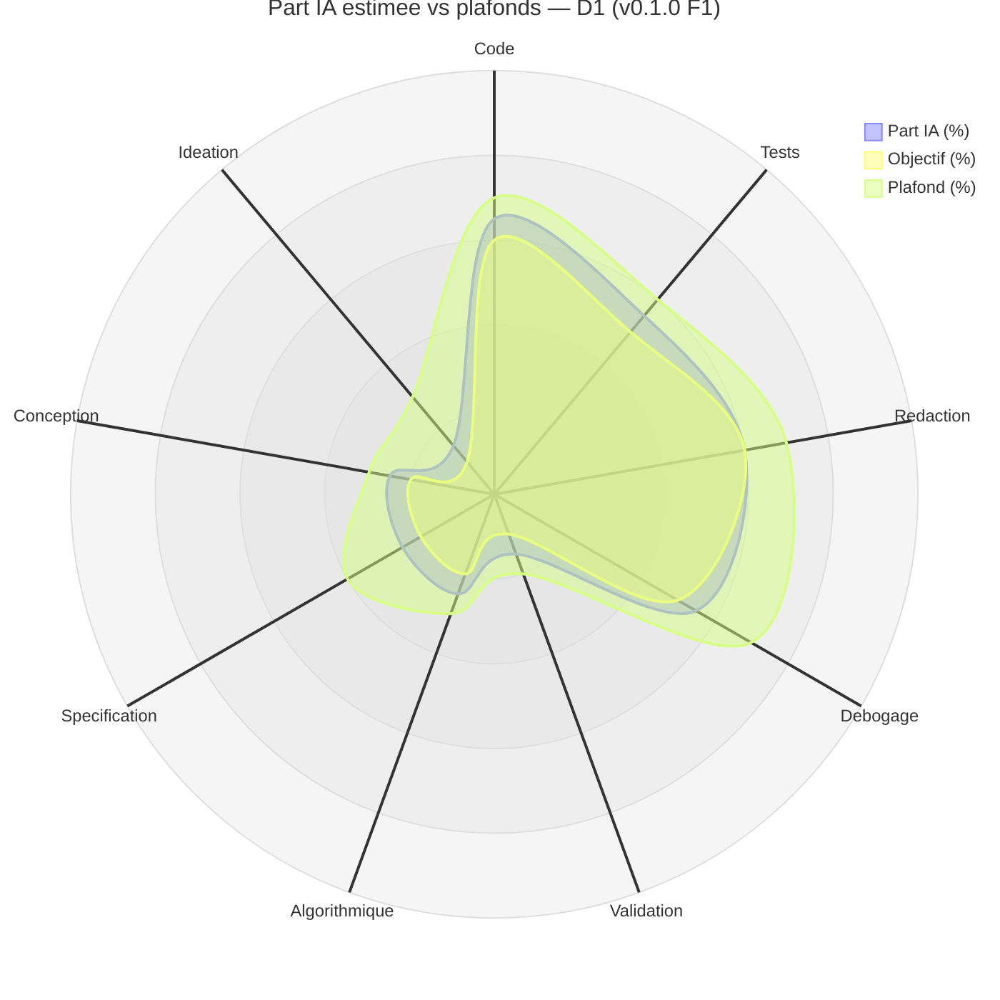

# F1 — Enquête à solution unique

- Version : v0.1.0
- Responsable unique : D1 — Mohamed BOUGHMADI (`MohamedBoughmadi`, https://github.com/MohamedBoughmadi)
- Issue : #11
- Statut : implémentée et vérifiée en local sur les 4 couches (`mohamed_boughmadi`) ; validée par @salahbekkaripro sur https://github.com/salahbekkaripro/MINDCRIME/pull/12.

## Besoin et scénario

En tant que joueur (mode Enquêteur), je demande la génération d'une nouvelle enquête depuis une partie, afin de disposer d'une énigme cohérente dont la solution (le coupable) est unique et déductible à partir des seuls indices visibles.

Parcours autonome (scénario S1) : depuis une nouvelle partie, le joueur déclenche la génération d'une enquête ; le moteur produit une vérité terrain cohérente et sélectionne un ensemble d'indices visibles garantissant un coupable unique, le système enregistre l'enquête en base de données, l'API restitue uniquement les données visibles et le front affiche le contexte du crime, les suspects et les indices accessibles. Ce parcours fonctionne avec son propre jeu de données autonome, sans dépendre des résultats de D2, D3, D4 ou D5 en v0.1.0.

## Modèle et algorithme

### Lien à `Partie` et entités du domaine (Java pur)

Une `Enquete` est rattachée à une `Partie` (entité pivot commune via `partieId`). Les entités du moteur (`moteur/modele/`) sont indépendantes de Spring et de JPA :

- `Enquete` : identifiant, `partieId`, graine (`seed`), `Crime` (lieu et créneau visibles ; coupable stocké séparément côté vérité terrain), liste des `Suspect`, liste des `Lieu`, liste des `Creneau`, liste des `Indice` (avec indicateur `visible`), `StatutUnicite`.
- `Suspect` : identifiant, nom, rôle/profil court.
- `Lieu` : identifiant, nom, ensemble de lieux adjacents (graphe non orienté fixe en v0.1.0).
- `Creneau` : identifiant ordonné (ex. `T1` = 20h, `T2` = 21h, `T3` = 22h).
- `Indice` : identifiant, type (`PRESENCE_LIEU`, `ABSENCE_LIEU`, `ALIBI_CONFIRME`, `INDICE_MATERIEL`), suspect concerné, lieu, créneau, texte descriptif structuré, booléen `visible`.
- `VeriteTerrain` : identifiant du coupable réel, table complète des présences `(Suspect, Creneau) -> Lieu`.
- `StatutUnicite` : énumération explicite `COUPABLE_UNIQUE`, `AUCUNE_SOLUTION`, `SOLUTIONS_MULTIPLES`, `RECHERCHE_INCOMPLETE`.

### Invariants

1. **Unicité du coupable réel** : une enquête valide possède exactement un coupable, présent sur le `lieuCrime` au `creneauCrime`.
2. **Non-ubiquité** : pour tout suspect et tout créneau, le suspect occupe exactement un lieu.
3. **Continuité spatio-temporelle** : entre deux créneaux consécutifs $t$ et $t+1$, un suspect reste dans le même lieu ou se déplace vers un lieu adjacent dans le graphe des lieux.
4. **Unicité déductible des seuls indices visibles** : en évaluant chaque suspect uniquement à l'aide des indices marqués `visible = true`, un et un seul suspect reste compatible avec le crime (et c'est le coupable réel).
5. **Reproductibilité** : à paramètres et graine (`seed`) identiques, le générateur produit strictement la même enquête.
6. **Non-divulgation** : ni l'identifiant du coupable ni la vérité terrain complète ne sont exposés dans les réponses API de consultation.

### Structures de données

- Graphe de lieux : liste d'adjacence `Map<LieuId, Set<LieuId>>`.
- Vérité terrain (emplois du temps) : table `Map<SuspectId, Map<Creneau, LieuId>>`.
- Générateur pseudo-aléatoire déterministe : `java.util.Random(seed)`.
- Ensemble des candidats encore compatibles : `Set<SuspectId>`.
- Pool d'indices candidats et liste finale d'indices visibles : `List<Indice>`.

### Algorithme : Génération procédurale par Backtracking sous contraintes + Sélection gloutonne d'indices

L'algorithme se déroule en deux phases afin d'intégrer les contraintes dès la construction (sans boucle aveugle de génération/rejet) :

1. **Phase 1 — Construction de la vérité terrain par backtracking :**
   - Tirage déterministe (via `seed`) du crime : 1 coupable $s^*$, 1 `lieuCrime`, 1 `creneauCrime`.
   - Fixation de la contrainte forte : position($s^*$, `creneauCrime`) = `lieuCrime`.
   - Affectation récursive des positions des suspects pour chaque créneau `(suspect, creneau)` dans un ordre de lieux mélangé par `seed`.
   - À chaque affectation, vérification immédiate des contraintes : non-ubiquité, adjacence sur le graphe entre $t-1$ et $t$, et respect des règles d'alibi (au moins un lieu distinct du `lieuCrime` à `creneauCrime` pour permettre d'innocenter les suspects innocents).
   - En cas d'impasse (domaine vide), retour arrière (*backtracking*) sur l'affectation précédente au lieu de jeter toute l'enquête.

2. **Phase 2 — Sélection gloutonne d'indices visibles et vérification d'unicité :**
   - Extraction d'un pool d'indices vrais issus de la vérité terrain (présence confirmée ailleurs qu'au `lieuCrime` à `creneauCrime`, présence à distance trop grande au créneau précédent/suivant, ou indice matériel cohérent).
   - Initialisation de l'ensemble des suspects compatibles $C$ avec tous les suspects.
   - Tant que $|C| > 1$ et qu'il reste des indices dans le pool : choisir de manière gloutonne un indice qui élimine au moins un suspect innocent de $C$ (sans jamais éliminer $s^*$), le marquer `visible = true` et mettre à jour $C$.
   - Vérification finale indépendante par `VerificateurUnicite` sur les seuls indices visibles :
     - Si $|C| = 1$ et $C = \{s^*\}$, retourner `COUPABLE_UNIQUE`.
     - Si le pool ne permet pas d'isoler $s^*$ ($|C| > 1$), déclencher un retour arrière sur le placement des innocents (dans la limite d'un budget maximal de nœuds explorés).
     - Si la limite est atteinte sans preuve d'unicité, retourner explicitement `RECHERCHE_INCOMPLETE` (ne jamais déclarer `COUPABLE_UNIQUE` après une recherche interrompue).

### Déroulé sur un exemple reproductible (`seed = 42`)

- **Paramètres :** 4 suspects (`Alice`, `Bob`, `Chloé`, `David`), 4 lieux en carré (`Salon`–`Bibliothèque`–`Cuisine`–`Jardin`–`Salon`), 3 créneaux (`20h`, `21h`, `22h`).
- **Tirage du crime :** coupable = `Bob`, lieu = `Bibliothèque`, créneau = `21h`.
- **Phase 1 (backtracking) :**
  - `Bob` est fixé à `Bibliothèque` à `21h` (ex. `Salon` à `20h`, `Bibliothèque` à `21h`, `Cuisine` à `22h`).
  - `Alice` est placée en `Jardin` à `21h` (non adjacent à `Bibliothèque` : alibi fort).
  - `Chloé` est placée en `Cuisine` à `21h` avec `David` en `Cuisine` à `21h` (témoignage croisé possible).
- **Phase 2 (sélection gloutonne) :**
  - Départ : $C = \{\text{Alice}, \text{Bob}, \text{Chloé}, \text{David}\}$.
  - Indice 1 (`ALIBI_CONFIRME`) : « Alice a été vue au Jardin à 21h » $\rightarrow$ élimine `Alice` ($C = \{\text{Bob}, \text{Chloé}, \text{David}\}$).
  - Indice 2 (`PRESENCE_LIEU`) : « Chloé et David étaient ensemble en Cuisine à 21h » $\rightarrow$ élimine `Chloé` et `David` ($C = \{\text{Bob}\}$).
  - Indice 3 (`INDICE_MATERIEL`) : « Une trace confirme le passage de Bob dans le Salon à 20h (adjacent à la Bibliothèque) » $\rightarrow$ renforce la cohérence sans éliminer `Bob`.
- **Vérification :** seul `Bob` reste compatible avec les 3 indices visibles $\rightarrow$ statut `COUPABLE_UNIQUE`, enquête validée.

### Complexité en temps et en mémoire

Soient $N$ le nombre de suspects, $T$ le nombre de créneaux, $L$ le nombre de lieux et $P$ la taille du pool d'indices ($P = O(N \cdot T)$) :

- **Temps :**
  - Phase 1 (backtracking) : pire cas théorique $O(L^{N \cdot T})$, fortement réduit en pratique par l'élagage sur le degré du graphe $d \le L$ et borné par un plafond de retours arrière (en v0.1.0 : $N \in [4, 6]$, $T = 3$, $L \in [4, 6]$).
  - Phase 2 (sélection gloutonne + vérification) : $O(P^2 \cdot N)$ au pire cas, soit polynomial en $N$ et $T$.
- **Mémoire :** $O(N \cdot T + L^2 + P)$ pour la table de présences, le graphe d'adjacence, le pool d'indices et la pile de récursion (profondeur maximale $N \cdot T$).

### Alternatives écartées et limites

- **Génération aléatoire + rejet pur (*Generate-and-Test*) :** écartée car coûteuse en rejets inutiles et moins maîtrisable sur les contraintes spatio-temporelles.
- **Algorithme purement glouton sans backtracking :** écarté car incapable de revenir en arrière en cas d'impasse (deux suspects indiscernables ou déplacement impossible).
- **Solveur SAT/CSP externe :** écarté en v0.1.0 pour conserver un moteur Java 21 pur, léger, lisible et sans dépendance lourde.
- **Limites connues en v0.1.0 :** graphe de lieux fixe prédéfini (génération procédurale de carte prévue en `D1-C` / v1.0.0) ; niveau de difficulté unique par défaut (budget d'indices paramétrable prévu en `D1-B` / v0.2.0) ; vérification d'unicité interne autonome (raccordement optionnel avec D2/D3/D5 prévu en intégration ultérieure).

## Impacts obligatoires

- **BD :** migration Flyway dédiée (numéro à coordonner avec le socle commun, ex. `V2__d1_enquetes.sql`) créant les tables `enquete` (FK vers `partie(id)`, `seed`, `lieu_crime`, `creneau_crime`, `coupable_id`, `statut_unicite`), `enquete_suspect` (`id`, `enquete_id`, `nom`, `profil`) et `enquete_indice` (`id`, `enquete_id`, `type`, `suspect_id`, `lieu`, `creneau`, `description`, `visible`), avec contraintes `NOT NULL`, `FOREIGN KEY` et index sur `enquete_id`.
- **Back :**
  - Domaine Java pur (zéro import Spring/JPA) : `moteur/modele/` (`Enquete`, `Crime`, `Suspect`, `Lieu`, `Creneau`, `Indice`, `TypeIndice`, `VeriteTerrain`, `StatutUnicite`) et `moteur/generation/` (`GenerateurEnqueteBacktracking`, `VerificateurUnicite`, `ParametresGeneration`, `ResultatGeneration`).
  - Application : ports dans `application/port/` (`EnqueteRepositoryPort`) et cas d'utilisation dans `application/enqueteur/` (`GenererEnqueteUseCase`, `ConsulterEnqueteUseCase`).
  - Infrastructure : entités JPA distinctes du modèle pur et adaptateur dans `infrastructure/persistence/`.
- **API REST :**
  - `POST /api/v1/parties/{partieId}/enquetes` : génère et persiste une enquête pour la partie (corps JSON optionnel `{ "seed": 42, "nombreSuspects": 5 }` avec Bean Validation). Retourne `201 Created` avec `EnqueteVisibleDto` (sans coupable ni vérité terrain).
  - `GET /api/v1/parties/{partieId}/enquetes/{enqueteId}` : retourne `200 OK` avec `EnqueteVisibleDto` (contexte du crime, suspects et indices visibles uniquement).
  - Erreurs au format `application/problem+json` : `400 Bad Request` (paramètres invalides), `404 Not Found` (partie ou enquête introuvable), `422 Unprocessable Entity` (génération impossible ou `RECHERCHE_INCOMPLETE`).
- **Front :** écran React + TypeScript dans `frontend/src/` permettant depuis une partie de lancer la génération d'une enquête (avec graine optionnelle), d'appeler `POST /api/v1/parties/{partieId}/enquetes`, puis d'afficher le lieu/créneau du crime, la liste des suspects et les indices visibles via l'API, sans logique métier côté client.

## Critères d'acceptation et tests prévus

- [x] Comportement nominal : générer une enquête depuis une partie crée l'enquête en BD, retourne `201 Created` et affiche le crime, les suspects et les indices visibles sur le front.
- [x] Invariant d'unicité : pour toute enquête générée avec statut `COUPABLE_UNIQUE`, le vérificateur confirme qu'un et un seul suspect est compatible avec les seuls indices visibles, et que ce suspect est le coupable réel.
- [x] Invariant de non-divulgation : aucun DTO retourné par l'API (`POST` et `GET`) ne contient l'identifiant du coupable ni les indices non visibles.
- [x] Cas limites et erreurs : paramètres hors bornes (`nombreSuspects < 3`, graine invalide si contrainte) renvoient `400` (`problem+json`) ; une `partieId` ou `enqueteId` inexistante renvoie `404` ; un budget d'exploration saturé renvoie `RECHERCHE_INCOMPLETE` sans jamais prétendre à l'unicité.
- [x] Propriété reproductible : deux appels au générateur avec la même graine (`seed = 42`) produisent strictement le même coupable, les mêmes suspects et les mêmes indices visibles.
- [x] Architecture hexagonale : un test ArchUnit confirme qu'aucune classe de `moteur/modele` ou `moteur/generation` ne dépend de Spring, JPA ou `api/`.

Relecteur et validation de conception : @salahbekkaripro (https://github.com/salahbekkaripro/MINDCRIME/pull/12)

## Bilan à compléter après réalisation

### Fichiers livrés

- **Moteur Java pur (`backend/src/main/java/fr/miage/mindcrime/moteur/`) :**
  - `modele/` : `Creneau.java`, `Crime.java`, `Enquete.java`, `Indice.java`, `Lieu.java`, `StatutUnicite.java`, `Suspect.java`, `TypeIndice.java`, `VeriteTerrain.java`.
  - `generation/` : `ParametresGeneration.java`, `ResultatGeneration.java`, `VerificateurUnicite.java`, `GenerateurEnqueteBacktracking.java`.
- **Application (`backend/src/main/java/fr/miage/mindcrime/application/`) :**
  - `port/EnqueteRepositoryPort.java`
  - `enqueteur/` : `GenererEnqueteUseCase.java`, `ConsulterEnqueteUseCase.java`, `PartieIntrouvableException.java`, `EnqueteIntrouvableException.java`, `GenerationEnqueteException.java`.
- **Persistance & configuration (`backend/src/main/`) :**
  - `resources/application.properties`, `resources/db/migration/V1__d1_enquetes.sql`
  - `java/fr/miage/mindcrime/MindcrimeApplication.java`
  - `infrastructure/configuration/EnqueteConfiguration.java`
  - `infrastructure/persistence/` : `PartieEntity.java`, `EnqueteEntity.java`, `EnqueteSuspectEntity.java`, `EnqueteIndiceEntity.java`, `SpringDataPartieRepository.java`, `SpringDataEnqueteRepository.java`, `EnqueteRepositoryAdapter.java`.
- **API REST (`backend/src/main/java/fr/miage/mindcrime/api/`) :**
  - `dto/` : `CreerPartieResponse.java`, `GenererEnqueteRequest.java`, `CrimeDto.java`, `SuspectDto.java`, `LieuDto.java`, `IndiceVisibleDto.java`, `EnqueteVisibleDto.java`.
  - `rest/` : `EnqueteController.java`, `ApiExceptionHandler.java`.
- **Tests backend (`backend/src/test/java/fr/miage/mindcrime/`) :**
  - `GenerateurEnqueteBacktrackingTest.java` (5 tests), `ArchitectureMoteurTest.java` (1 test ArchUnit), `api/rest/EnqueteControllerIntegrationTest.java` (4 tests MockMvc).
- **Frontend React + TypeScript (`frontend/`) :**
  - `package.json`, `tsconfig.json`, `vite.config.ts`, `index.html`, `src/main.tsx`, `src/App.tsx`, `src/styles.css`, `src/api/enqueteApi.ts`, `src/types/enquete.ts`.

### Commandes exécutées et résultats constatés

1. **Suite complète des tests backend :**
   - Commande : `mvn -f backend/pom.xml test`
   - Environnement : OpenJDK 25 LTS (`Temurin-25+36`, compilation `--release 21`), Maven 3.9.9, Spring Boot 3.5.0.
   - Résultat : `Tests run: 10, Failures: 0, Errors: 0, Skipped: 0` (`BUILD SUCCESS`).
     - `GenerateurEnqueteBacktrackingTest` : 5/5 (unicité sur indices visibles, reproductibilité à graine identique, continuité spatio-temporelle, `RECHERCHE_INCOMPLETE` sur budget saturé, rejet des paramètres invalides).
     - `ArchitectureMoteurTest` : 1/1 (aucune dépendance du moteur vers Spring, JPA ou `api/`).
     - `EnqueteControllerIntegrationTest` : 4/4 (cycle `POST partie` → `POST enquete` → `GET enquete` sans divulgation du coupable, `400 problem+json` si `nombreSuspects = 2`, `404 problem+json` si partie ou enquête inconnue).
2. **Build frontend TypeScript + Vite :**
   - Commande : `npm --prefix frontend run build` (Node v25.8.2, npm 11.11.1).
   - Résultat : `tsc -b` sans erreur, `28 modules transformed`, `built in 588ms`.
3. **Démonstration en live (parcours S1) :**
   - Backend : `mvn -f backend/pom.xml spring-boot:run` (`http://localhost:8080`).
   - Frontend : `npm --prefix frontend run dev` (`http://localhost:5173`).
   - Observation navigateur + DevTools Network :
     - `POST /api/v1/parties` → `201` (`PARTIE-ea2902d9`).
     - `POST /api/v1/parties/PARTIE-ea2902d9/enquetes` (`seed = 42`, `nombreSuspects = 5`) → `201` (`ENQ-PARTIE-ea2902d9-42`).
     - `GET /api/v1/parties/PARTIE-ea2902d9/enquetes/ENQ-PARTIE-ea2902d9-42` → `200`.
     - Vérification manuelle du JSON reçu : crime en `Jardin (L4)` à `20h`, 5 suspects (`S1`–`S5`), 5 indices visibles (`IND-13`, `IND-7`, `IND-1`, `IND-4`, `IND-16`), `statutUnicite = COUPABLE_UNIQUE`, absence totale de `coupable` et `veriteTerrain`. Déduction confirmée : `S2`, `S3`, `S5` éliminés à `20h`, `S4` éliminé par non-adjacence (`L2` Bibliothèque à `21h`), seule `S1` (Alice Moreau) reste compatible (`L1` Salon à `21h`, adjacent à `L4`).

### Limites constatées

- **Coordination Flyway :** la migration s'appelle actuellement `V1__d1_enquetes.sql` avec `CREATE TABLE IF NOT EXISTS partie` pour l'autonomie en v0.1.0 ; son numéro devra être coordonné (`V2__...`) lors de la fusion avec le socle commun sur `main`.
- **Base locale par défaut :** H2 en mémoire (`MODE=PostgreSQL`) par défaut pour tourner hors conteneur ; surchargeable vers PostgreSQL via `DB_URL`, `DB_USER`, `DB_PASSWORD`.
- **Avertissements JDK 25 / ArchUnit 1.3.0 :** des warnings `Unsupported class file major version 69` apparaissent sur les classes système `java.base` lors du scan ArchUnit (repli en import simplifié, sans empêcher le contrôle des packages du projet ni le succès du test).
- **Relecture humaine :** validée par @salahbekkaripro sur https://github.com/salahbekkaripro/MINDCRIME/pull/12.

### Usage de l'IA, éléments repris / modifiés / rejetés et araignée des compétences

- **Usage de l'IA :** assistance de Gemini pour structurer la fiche de conception, générer les squelettes des classes Java 21 / Spring Boot / Flyway / React TypeScript, et diagnostiquer des blocages d'environnement (installation Maven 3.9.9, encodage/placement des fichiers, erreur TypeScript `vite/client`, filtrage DevTools).
- **Éléments repris :** records Java 21 du moteur pur, séparation hexagonale (ports/use cases/adaptateur JPA), gestion `ProblemDetail` (`application/problem+json`), structure des tests JUnit 5 / MockMvc / ArchUnit et écran minimal S1.
- **Éléments modifiés :** version parent Spring Boot ajustée à `3.5.0` dans `backend/pom.xml`, ajout manuel de `"types": ["vite/client"]` dans `frontend/tsconfig.json`, suppression d'un fichier parasite `backend/src/pom.xml`, repositionnement des classes de test dans `src/test/java`.
- **Éléments rejetés :** installation via `winget install Apache.Maven` (package introuvable), dépendance externe SAT/CSP écartée au profit du backtracking pur, aucune logique métier de résolution ajoutée côté frontend.

| Axe | Part IA estimée (%) | Objectif (%) | Plafond (%) | Plafond validé |
| --- | :---: | :---: | :---: | :---: |
| Code | 65 | 60 | 70 | Oui |
| Tests | 55 | 50 | 60 | Oui |
| CI/CD | null (N/A) | 60 | 80 | N/A |
| Rédaction | 60 | 60 | 70 | Oui |
| Débogage | 55 | 50 | 70 | Oui |
| Validation | 15 | 10 | 20 | Oui |
| Algorithmique | 25 | 20 | 30 | Oui |
| Spécification | 25 | 20 | 40 | Oui |
| Conception | 25 | 20 | 30 | Oui |
| Idéation | 15 | 10 | 30 | Oui |

*(Axe `CI/CD` : `null` / non applicable sur cette feature v0.1.0 ; source canonique : `doc/membres/D1-mohamed-boughmadi/part-ia.json`.)*